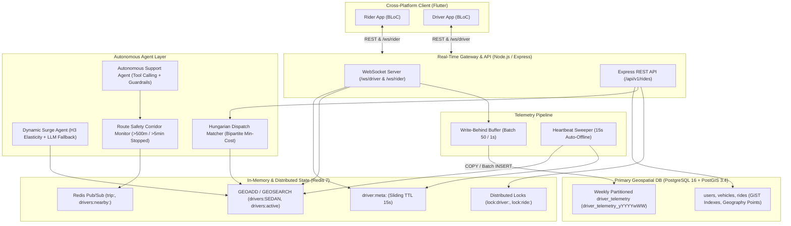
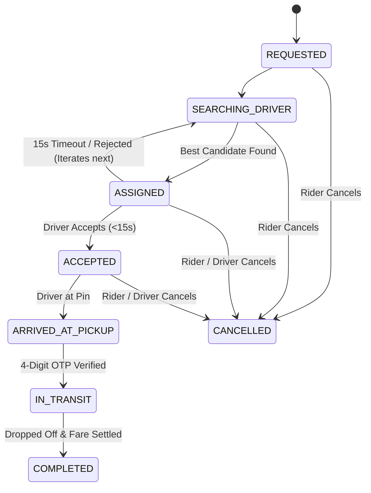

# Enterprise Event-Driven Ride-Hailing Platform

A full-stack, AI-agent-augmented, distributed ride-hailing platform built to mirror production-grade mobility systems (e.g., Uber, Ola). Features PostGIS geospatial indexing, weekly partitioned telemetry traces, Redis 7 spatial search with sliding TTLs, Redlock distributed concurrency control, multi-factor Kuhn-Munkres Hungarian dispatch, real-time safety corridor monitoring, autonomous customer support agents with tool-calling guardrails, and a cross-platform Flutter client with Clean Architecture and BLoC state management.

---

## 1. System Topology & Architecture



---

## 2. Tech Stack

| Layer | Technologies |
|---|---|
| **Mobile Frontend** | Flutter 3.x, Dart, `flutter_bloc`, `google_maps_flutter`, `dio`, `web_socket_channel`, `equatable` |
| **Backend API** | Node.js 22+, TypeScript 5.6, Express 4.21, `tsx` |
| **Real-Time Streaming** | Native WebSockets (`ws`), Redis Pub/Sub |
| **In-Memory & Geospatial** | Redis 7, `GEOADD`, `GEOSEARCH`, Sliding TTLs, Uber H3 Cell Indexing (Res 8) |
| **Concurrency Control** | Redis Redlock algorithm with token-safe atomic Lua script releases |
| **Primary Database** | PostgreSQL 16 with PostGIS 3.4, GiST spatial indexing, ISO weekly range partitioning |
| **Validation & Security** | Zod 3.25 schemas, cryptographic constant-time OTP generator & verifier |
| **Autonomous AI Agents** | Structured schema tool-calling, 800ms race timeout with deterministic rule fallbacks |

---

## 3. Core Subsystems

### 3.1 Geospatial Telemetry & State Pipeline
- **Continuous Telemetry:** Driver mobile clients emit telemetry packets every 3–4 seconds:
  `{ type: "TELEMETRY", driverId, lat, lng, bearing, speed, timestamp }`
- **Dual Indexing:** Coordinates are registered into vehicle-specific (`drivers:SEDAN`, `drivers:BIKE`, `drivers:SUV`) and global active sets (`drivers:active`) via `GEOADD`.
- **Sliding TTL:** Transient telemetry hashes (`driver:meta:<id>`) expire automatically after 15 seconds unless refreshed by an incoming heartbeat.
- **Auto-Offline Background Worker:** `HeartbeatWorker` sweeps registered active drivers. If silent for $>15\text{ s}$, the driver is evicted from spatial indexes and an auto-offline event is published.
- **Write-Behind Telemetry Buffer:** High-throughput driver telemetry is staged in an in-memory ring buffer (`TelemetryBufferService`) and flushed in bulk (batch size 50 or 1s intervals) to prevent PostgreSQL connection pool exhaustion.

### 3.2 Weekly Partitioned PostGIS Database
- **ISO Weekly Partitioning:** `driver_telemetry` is partitioned by range on `timestamp`:
  `driver_telemetry_yYYYYwWW` (e.g., `driver_telemetry_y2026w45`).
- **GiST Spatial Indexing:** Tables use PostgreSQL `geometry(Point, 4326)` for instant spatial queries:
  - `idx_rides_pickup_location` & `idx_rides_dropoff_location`
  - `idx_driver_telemetry_location`
- **Dynamic Partition Provisioning:** `create_weekly_telemetry_partition(target_date)` automatically provisions future weekly partition tables with proper constraints and GiST indexes.

### 3.3 Concurrency Control & Distributed Redlock
- **Atomic Acquisition:** Distributed locks are acquired using `SET lock:<resource_id> <uuid_token> NX PX <ttl_ms>`.
- **Token-Safe Lua Release:** Locks are released atomically via Lua script to guarantee only the acquiring process can release them:
  ```lua
  if redis.call("get", KEYS[1]) == ARGV[1] then
    return redis.call("del", KEYS[1])
  else
    return 0
  end
  ```
- **Guaranteed Isolation:**
  - `lock:driver:<driverId>`: Prevents drivers from receiving or accepting concurrent offers.
  - `lock:ride:<rideId>`: Prevents conflicting state transitions between riders, drivers, and timeout workers.

### 3.4 Deterministic Ride Lifecycle State Machine


### 3.5 AI Agent Layer & Optimization Models
1. **Dynamic Surge Pricing Agent (`DynamicSurgeAgent`):**
   - Maps coordinates to Uber H3 hex cells (resolution 8).
   - Elasticity Formula:
     $$M = \min\left(3.5, \max\left(1.0, 1.0 + 0.5 \cdot \frac{D - S}{S + 1.0}\right)\right) \times \text{WeatherMultiplier}$$
   - Structured JSON LLM reasoning wrapped in an 800ms race timeout, falling back automatically to the rule-based formula on timeout or failure.
2. **Kuhn-Munkres Hungarian Matcher (`BipartiteDispatchMatcher`):**
   - Solves the global minimum weight bipartite matching problem when multiple rides compete for drivers in overlapping spatial cells, optimizing platform-wide pickup latency.
3. **Route Corridor Safety Agent (`RouteSafetyAgent`):**
   - Continuously computes the cross-track distance of moving vehicles against the planned corridor polyline using minimum segment projection.
   - Triggers `SAFETY_CORRIDOR_DEVIATION` alerts if the vehicle deviates $>500\text{ m}$.
   - Detects unauthorized stationary stops ($\le 2\text{ km/h}$ for $>5\text{ mins}$) and emits `SAFETY_UNSCHEDULED_STOP` alerts to the `trip:<rideId>` pub/sub channel.
4. **Autonomous Support Agent (`CustomerSupportAgent`):**
   - Equips LLM agents with 4 strict JSON tools: `lookupRideDetails`, `lookupTelemetryAudit`, `issueRefund`, and `escalateToHuman`.
   - Protects against prompt injections and enforces financial guardrails (refunds cannot exceed trip fare and are capped at \$50.00 without human manager escalation).

### 3.6 Flutter Cross-Platform Client
- **Clean Architecture:** Strict layer isolation (`core/`, `features/rider/`, `features/driver/`, `features/shared_map/`).
- **BLoC State Management:** `RiderBloc` and `DriverBloc` mirror backend state machines with immutable state classes.
- **Smooth Marker Slerp:** Slerp bearing interpolation and position linear interpolation along the shortest angular distance (`MarkerInterpolation.interpolateBearing`).
- **Interactive UI:**
  - Role switcher (`Rider` vs `Driver`).
  - Vehicle class selector (BIKE, SEDAN, SUV) with dynamic surge banners ($M > 1.0$).
  - Radar scanning view during `SEARCHING_DRIVER`.
  - 15-second circular countdown offer dialog for drivers.
  - Constant-time 4-digit OTP verification pin pad.
  - Live turn-by-turn simulation and trip receipt summary.

---

## 4. API Reference

### REST Endpoints (`/api/v1`)

| Method | Path | Description |
|---|---|---|
| `GET` | `/health` | Server uptime, PostGIS, and Redis health check |
| `POST` | `/api/v1/rides/request` | Request a ride (validates rider, coordinates, and creates OTP) |
| `POST` | `/api/v1/rides/:id/accept` | Driver accepts dispatched offer under Redlock |
| `POST` | `/api/v1/rides/:id/reject` | Driver rejects offer; engine iterates to next candidate |
| `POST` | `/api/v1/rides/:id/arrived` | Driver arrives at pickup location |
| `POST` | `/api/v1/rides/:id/start` | Driver starts trip after verifying 4-digit rider OTP |
| `POST` | `/api/v1/rides/:id/complete` | Complete ride and finalize billing |
| `POST` | `/api/v1/rides/:id/cancel` | Cancel ride (with role and reason validation) |
| `GET` | `/api/v1/rides/:id` | Fetch full ride details and status |
| `POST` | `/api/v1/pricing/estimate` | Compute upfront fare breakdown and dynamic surge |
| `GET` | `/api/v1/drivers/nearby` | Query nearby active drivers within radius |
| `POST` | `/api/v1/driver/duty` | Toggle driver duty status (`ONLINE` / `OFFLINE`) |
| `POST` | `/api/v1/support/chat` | Autonomous customer support agent chat & triage |

### WebSocket Channels

| Route | Direction | Payload Type | Description |
|---|---|---|---|
| `/ws/driver` | Client $\to$ Server | `TELEMETRY` | Emit continuous location, bearing, speed |
| `/ws/driver` | Client $\to$ Server | `DUTY_STATUS` | Switch online/offline duty status |
| `/ws/driver` | Server $\to$ Client | `RIDE_OFFER` | 15s dispatched ride offer |
| `/ws/rider` | Client $\to$ Server | `TRACK_TRIP` | Subscribe to live trip updates |
| `/ws/rider` | Server $\to$ Client | `TRIP_TELEMETRY` | Live driver coordinates, bearing, and alerts |

---

## 5. Verification & Testing

The platform includes full test coverage across all subsystems:

```bash
# 1. Vitest Comprehensive Test Suite (18 test files, 78 tests)
cd backend && npm test

# 2. Native Node.js Test Suite across all 5 Phases
cd backend && npm run test:unit

# 3. TypeScript Compilation Check
cd backend && npm run build
```

### Verified Test Results
- **Vitest:** 18 test files passed (78 tests, 0 failures, 100% pass rate).
- **Native Suite:** 13 suites passed (32 tests across all 5 phases, 0 failures).
- **TypeScript:** 0 compilation errors with strict mode enabled.
- **E2E Integration:** Full lifecycle verified end-to-end (Driver Telemetry $\to$ Spatial Search $\to$ Dynamic Surge $\to$ Request $\to$ Offer $\to$ Accept $\to$ Arrive $\to$ OTP $\to$ Complete $\to$ AI Support Refund).

---

## 6. Quickstart & Local Development

### Prerequisites
- Node.js 22+ & npm
- Docker & Docker Compose
- (Optional) Flutter SDK 3.x for mobile execution

### Step 1: Start PostgreSQL PostGIS & Redis
```bash
docker compose -f docker/docker-compose.yml up -d
```

### Step 2: Install Backend Dependencies & Run Migrations
```bash
cd backend
npm install
npm run migrate
npm run seed
```

### Step 3: Run the Backend Service
```bash
# Development mode with hot reload
npm run dev

# Or production build
npm run build
npm start
```
Server runs at `http://localhost:4000` with WebSockets on `/ws/driver` and `/ws/rider`.

### Step 4: Run the Flutter Client
```bash
cd mobile
flutter pub get
flutter run
```
Use the role switch toggle in the top bar to switch between Rider and Driver interfaces.
